# Manual de uso · GIS Comercial

- **Mapa:** https://montieur.github.io/gis-comercial/ (computador e smartphone)
- **Manual em PDF:** [Manual_GIS_Comercial.pdf](https://montieur.github.io/gis-comercial/dados/Manual_GIS_Comercial.pdf)
- **Repositório:** https://github.com/montieur/gis-comercial

O **GIS Comercial**, da **tecgeo**, mostra para qualquer município do Brasil a área urbana, a área rural e a extensão de **vias transitáveis por veículo dentro das manchas urbanas**, que é a base de quantitativos do mapeamento 360°. A base começou com os **39 municípios de Pernambuco do CONIAPE** e cresce a cada município pesquisado: quem pesquisa um município novo gera os dados na hora, e eles ficam guardados para todos. Os municípios de PE ainda sem dados aparecem em cinza.

- [Parte 1: Usar o mapa](#parte-1-usar-o-mapa)
- [Parte 2: Entender os números](#parte-2-entender-os-números)
- [Parte 3: Baixar os dados](#parte-3-baixar-os-dados)
- [Parte 4: Atualizar e publicar (manutenção)](#parte-4-atualizar-e-publicar-manutenção)

---

## Parte 1: Usar o mapa

### A tela

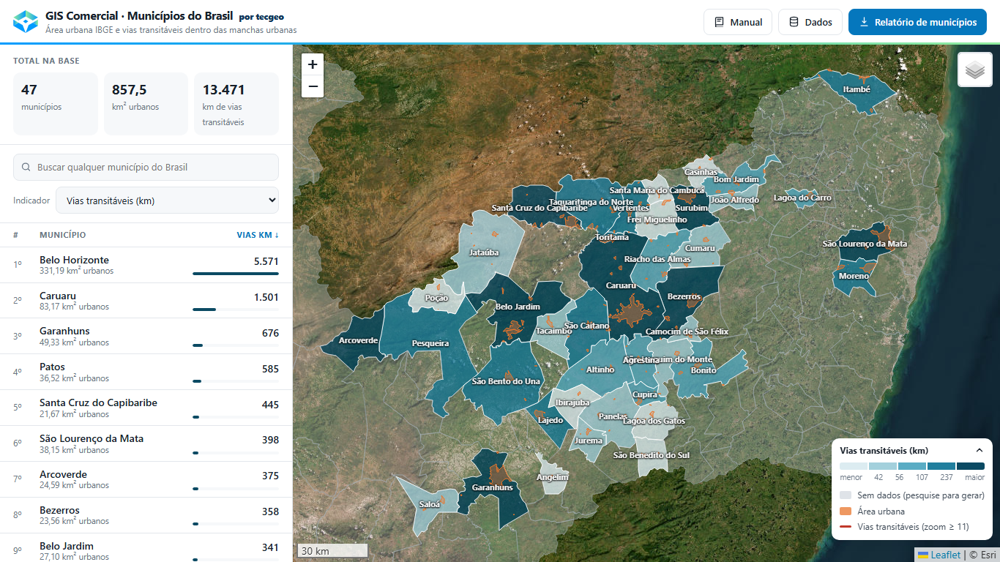
*Tela inicial: painel à esquerda, mapa à direita, com os 39 municípios coloridos por km de vias transitáveis.*

| Área | O que tem |
|---|---|
| **Cabeçalho** | Marca tecgeo, título e os botões **Manual** (esta janela), **Dados** (downloads) e **Relatório de municípios** (PDF único com os municípios que você escolher) |
| **Resumo** | Totais da base: municípios, km² urbanos e km de vias transitáveis |
| **Busca e indicador** | Campo para achar um município e escolha da variável que colore o mapa |
| **Lista** | Municípios ranqueados pelo indicador escolhido, com barra comparativa |
| **Mapa** | Imagem de satélite com os municípios coloridos e nomeados, áreas urbanas (laranja) e vias (vermelho) |

No smartphone a tela muda ([veja abaixo](#no-smartphone)).

### Escolher o indicador

Em **Indicador**, escolha a variável que colore o mapa e ordena a lista:

- **Vias transitáveis (km)**: extensão de vias para o mapeamento 360°
- **Área urbana (km²)**: soma das manchas urbanas do IBGE
- **Densidade de vias (km/km²)**: km de vias por km² de área urbana
- **Área urbana / território (%)**: quanto do município é urbano

As cores vão de claro (menor) a escuro (maior), em 5 faixas com a mesma quantidade de municípios. Os limites das faixas aparecem na legenda.

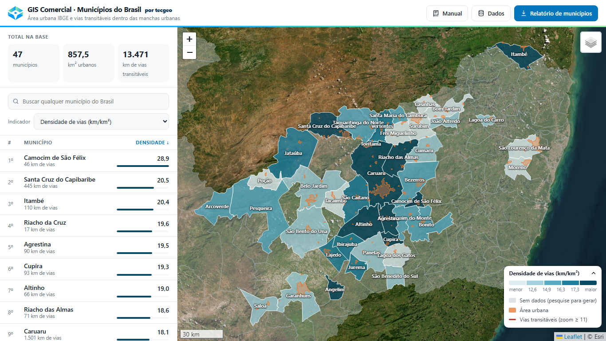
*Indicador "Densidade de vias": a lista passa a ser ranqueada por km/km² e a legenda mostra as novas faixas.*

### Encontrar um município

- **Na lista:** clique no nome. Para ordenar, clique em **Município** (ordem alfabética) ou no cabeçalho do indicador (maior ou menor primeiro).
- **Na busca:** digite parte do nome. Acentos são ignorados, então "sao bento" encontra São Bento do Una.
- **No mapa:** clique dentro do limite do município. Só o limite municipal é clicável; áreas urbanas e vias não interceptam o clique.

Municípios em cinza ainda não têm dados na base. Com o servidor ativo, clicar num deles abre a tela para gerar os dados (próxima seção).

### Pesquisar qualquer município do Brasil

> Esta função depende do servidor do GIS Comercial. Se a busca só filtra os municípios que já estão na lista, o servidor ainda não foi ativado neste endereço (veja a [Parte 4](#parte-4-atualizar-e-publicar-manutenção)).

Digite o nome na barra de busca (a partir de 2 letras). As sugestões aparecem em duas seções:

- **Na base:** municípios que já têm dados. Clique para abrir.
- **Outros municípios do Brasil:** qualquer um dos 5.571 municípios do IBGE, com a UF. Clique para gerar os dados.

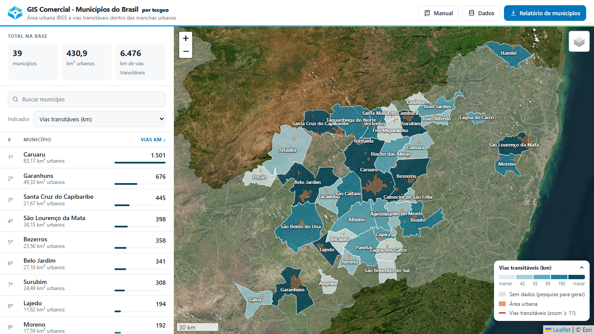
*Digitando "sao bento": São Bento do Una já está na base; os demais são sugestões para gerar.*

Ao escolher um município sem dados, o mapa mostra o contorno dele e a tela **Gerar dados**. O botão envia o pedido ao servidor, que usa o **mesmo método dos demais municípios**: lê os setores censitários urbanos do IBGE (2022), busca no OpenStreetMap as vias transitáveis por veículo, recorta dentro das manchas urbanas e mede.

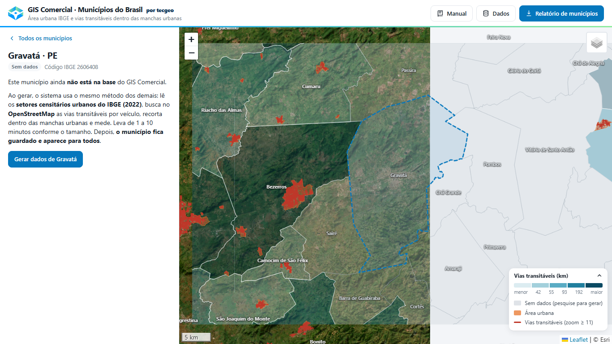

- **Tempo:** de 1 a 10 minutos, conforme o tamanho do município. A tela mostra o andamento e o tempo decorrido.
- **Pode sair da tela:** o pedido continua no servidor. Quando fica pronto, o município entra na base e uma mensagem avisa. Ao reabrir o mapa no mesmo aparelho, o acompanhamento é retomado.
- **Fica guardado para todos:** depois de gerado, o município aparece para qualquer pessoa que abrir o mapa, com a origem **Pesquisa**. Os do CONIAPE têm a origem **CONIAPE**.
- **Limites:** cada visitante pode pedir até 5 municípios por hora. Se o pedido falhar (os servidores do OpenStreetMap às vezes ficam fora do ar), ele é tentado de novo sozinho até 3 vezes e depois mostra o erro, com a opção de tentar de novo.

### Fontes de dados e atualização

Ao abrir um município que já está na base, o cartão **Fontes de dados** mostra de onde vêm os números e **confere se as fontes mudaram** desde a geração:

- **IBGE:** compara a data do arquivo de setores censitários com a registrada na geração.
- **OpenStreetMap:** pergunta quantas vias mudaram na área desde a data da extração.

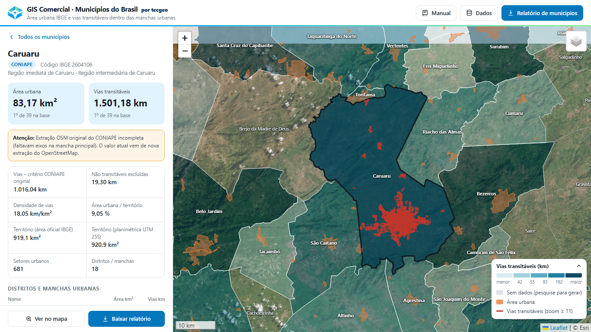
*Nenhuma fonte mudou: o mapa informa que os dados já estão atualizados e quando foi a conferência.*

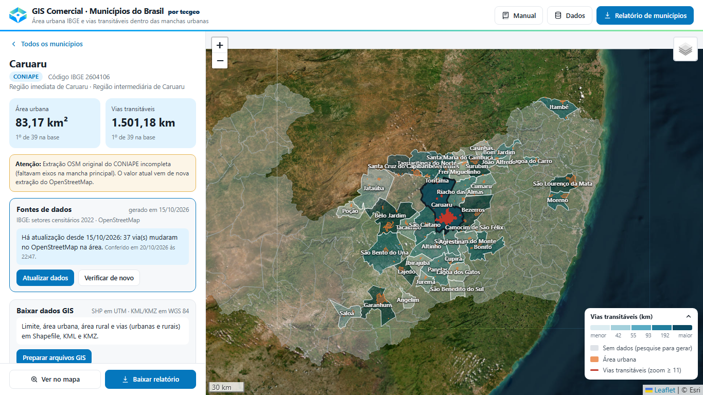
*Houve mudança: o cartão diz quantas vias mudaram (e a proporção) e oferece **Atualizar dados**. O OpenStreetMap recebe edições todos os dias, então mudanças pequenas são comuns; a proporção ajuda a decidir se vale atualizar.*

Se não der para conferir (por exemplo, o servidor do OpenStreetMap fora do ar), o cartão diz que **não foi possível confirmar**, em vez de afirmar que está atualizado. **Verificar de novo** refaz a conferência. **Atualizar dados** gera o município de novo e substitui o anterior para todos.

### O detalhe do município

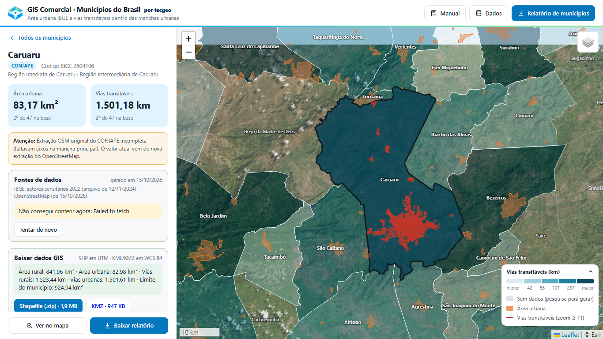
*Caruaru selecionado: contorno forte no mapa, vias em vermelho e o detalhe no painel.*

Ao selecionar um município, o painel mostra:

- **Área urbana** e **vias transitáveis** em destaque, com a posição entre os 39 (ex.: "3º de 39 no CONIAPE")
- **Vias, critério CONIAPE original**: o número antigo, para comparação ([veja a Parte 2](#parte-2-entender-os-números))
- **Não transitáveis excluídas**: km de vias privadas, estacionamentos e garagens que ficaram de fora
- Densidade, % urbano, território (área oficial IBGE e área planimétrica UTM), setores urbanos e número de manchas
- **Distritos e manchas urbanas**: cada mancha com área e km de vias, da maior para a menor. **Clique numa mancha** para aproximar o mapa nela: a mancha ganha um contorno tracejado e a linha fica marcada. Clique de novo na mesma linha para voltar ao município inteiro.

No mapa, o município selecionado ganha contorno forte, os outros ficam esmaecidos e as vias dele aparecem.

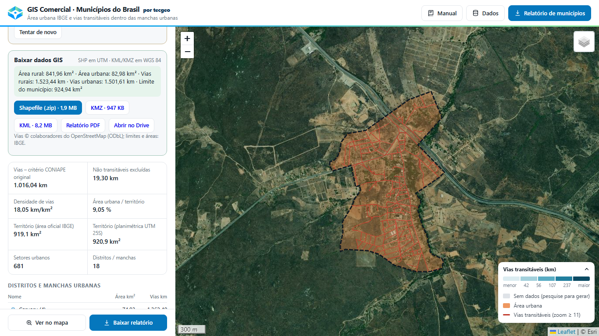
*Clique em "Carapotós (4)" na tabela de manchas: o mapa aproxima na mancha (contorno tracejado) e mostra as vias dela.*

Para voltar à lista, use **Todos os municípios** ou a tecla **Esc**. O botão **Ver no mapa** reenquadra o município.

### Camadas e mapa base

No botão de camadas (canto superior direito do mapa):

- **Mapa base**: Satélite (padrão), Cinza claro ou OpenStreetMap. Sobre o satélite os nomes ficam em branco; nos mapas claros, em escuro.
- **Nomes dos municípios**: os da base aparecem desde a abertura do mapa; os sem dados (cinza), a partir de uma aproximação maior (zoom 10)
- **Áreas urbanas**: manchas urbanas do IBGE (laranja)
- **Vias transitáveis**: aparecem com zoom ≥ 11, ou sempre para o município selecionado

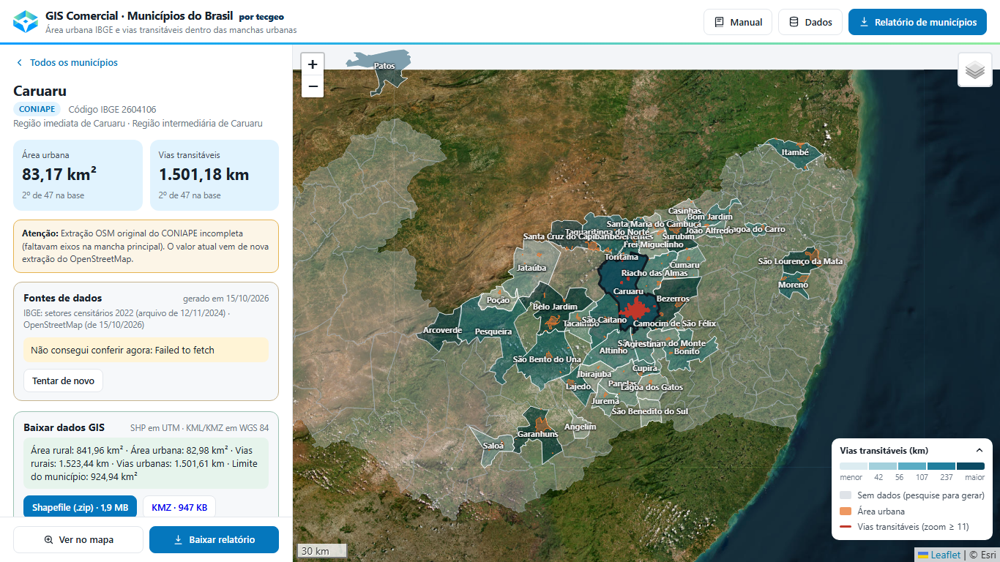
*Zoom no centro de Caruaru: cada linha vermelha é um trecho de via transitável dentro da mancha urbana.*

### Baixar dados GIS (Shapefile, KML e KMZ)

No detalhe de qualquer município da base aparece o cartão **Baixar dados GIS**, com os arquivos prontos para QGIS, ArcGIS e Google Earth. Eles ficam guardados no **Google Drive** da tecgeo, numa pasta por estado e por município:

| Arquivo | Uso | Sistema de coordenadas |
|---|---|---|
| Shapefile (.zip) | QGIS, ArcGIS, CAD | SIRGAS 2000 / UTM do fuso do município |
| KMZ | Google Earth, celular | WGS 84 |
| KML | Google Earth, outros programas | WGS 84 |
| Relatório PDF | Leitura, envio ao cliente | — |

Cada arquivo traz cinco camadas: **limite do município**, **área urbana** (manchas IBGE 2022), **área rural** (limite menos a área urbana), **vias urbanas** e **vias rurais** (só as transitáveis por veículo, do OpenStreetMap). O zip do Shapefile inclui um `LEIA-ME.txt` com fontes e licença.

O botão **Abrir no Drive** leva à pasta do município, com todos os arquivos juntos. O **Relatório PDF** é o mesmo relatório do mapa (abaixo), gerado pela automação e trocado pelo novo sempre que os dados do município mudam. Na mesma pasta raiz do Drive fica a planilha **GIS Comercial - Municípios**, com uma linha por município (áreas, km de vias, data de geração e links para os arquivos), atualizada a cada geração.

Se o cartão mostrar **Preparar arquivos GIS**, clique: o servidor gera os arquivos em alguns minutos e o cartão se atualiza sozinho. Notas: o limite é a união dos setores censitários do IBGE 2022; as vias do OpenStreetMap exigem a atribuição "© colaboradores do OpenStreetMap" (licença ODbL).

### Baixar relatórios

**Relatório de um município:** no detalhe, clique em **Baixar relatório** e escolha uma opção.

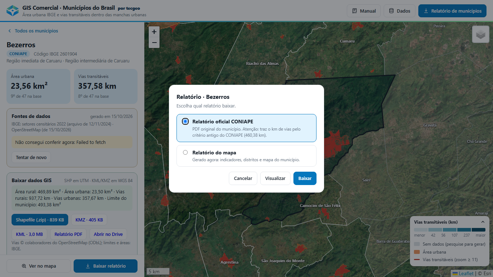
*Escolha do relatório de Bezerros: o oficial avisa que usa o critério antigo de vias.*

| Opção | O que é |
|---|---|
| **Relatório oficial CONIAPE** | PDF original do município, baixado do repositório. Só aparece para os 39 municípios do CONIAPE. **Atenção:** traz o km de vias pelo critério antigo. |
| **Relatório do mapa** | PDF gerado na hora com mapa base, limite, áreas urbanas, vias, escala, indicadores atuais e tabela de manchas |

**Visualizar antes de baixar:** o botão **Visualizar** abre o PDF numa janela sobre o mapa, com **Baixar PDF** e **Abrir em nova aba**. No celular, a visualização abre direto numa nova aba.

**Relatório de municípios (PDF único):** o botão do cabeçalho abre a lista dos municípios da base. Marque os que quiser (há busca por nome, filtro por estado, **Marcar os visíveis** e **Limpar**) e clique em **Gerar PDF** ou **Visualizar**. O município aberto no momento já vem marcado.

O PDF traz:

| Parte | Conteúdo |
|---|---|
| **Resumo** | Mapa com os municípios escolhidos em destaque; totais de municípios, área urbana, vias transitáveis e densidade; tabela comparativa (território, área urbana, vias, densidade e % urbano) com linha de total |
| **Uma página por município** | O mesmo conteúdo do relatório do mapa. Desmarque **Uma página por município** para gerar só o resumo |

O PDF já vem com marcadores (o índice lateral do leitor de PDF) para pular direto a cada município. Com muitos municípios e páginas individuais, a geração demora mais e o arquivo fica maior, porque cada página baixa o seu mapa base.

Os PDFs são gerados no próprio navegador e precisam de internet para baixar o mapa base. Sem conexão, o PDF sai com fundo liso e um aviso.

### Manual e dados dentro do mapa

O botão **Manual** abre este manual numa janela sobre o mapa, com atalhos para as quatro partes. O botão **Dados** abre a mesma janela já na [Parte 3](#parte-3-baixar-os-dados). Em **Salvar em PDF** você baixa o manual completo, com os prints. Para fechar, use o **×**, a tecla **Esc** ou clique fora da janela.

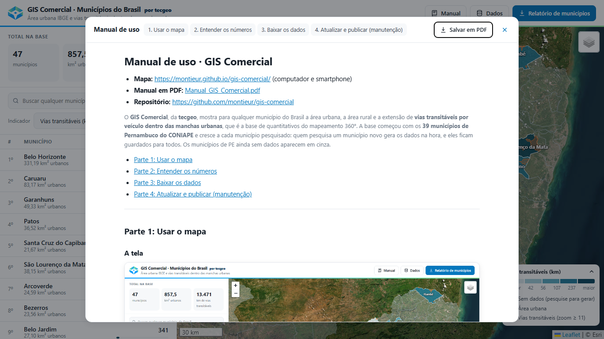

### No smartphone

No celular, o mapa ocupa a tela toda e as informações ficam num **painel que desliza de baixo para cima**:

- **Arraste a alça** (o traço no topo do painel) para cima ou para baixo, ou **toque nela** para alternar entre três alturas: recolhido (só os totais, mapa quase inteiro), meio e tela cheia.
- Ao **tocar na busca**, o painel abre em tela cheia para o teclado não cobrir a lista.
- Ao **escolher um município**, o painel vai para o meio: o município aparece enquadrado em cima e o detalhe embaixo.
- A legenda começa recolhida; toque no título dela para abrir.
- No cabeçalho, os botões mostram só os ícones: manual, dados e relatório de municípios.

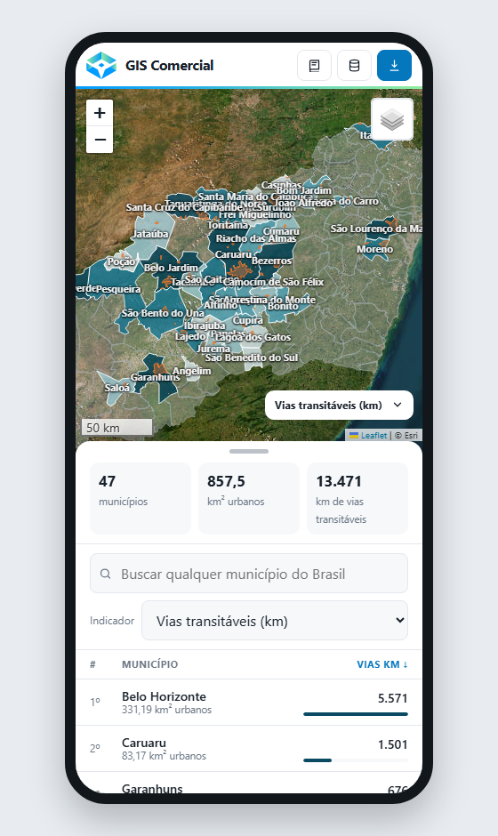 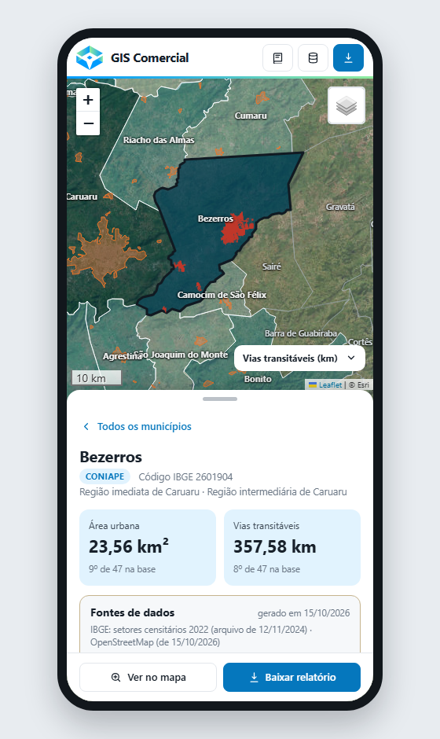

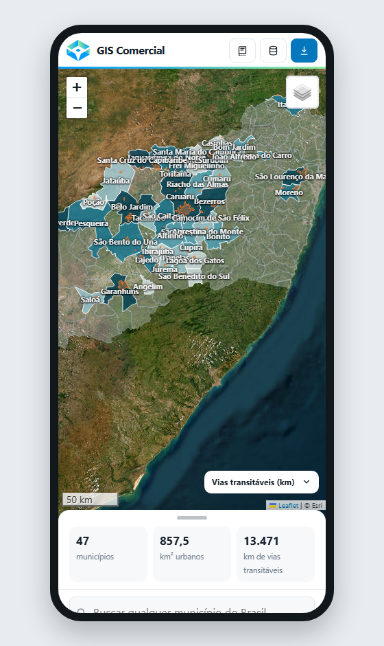 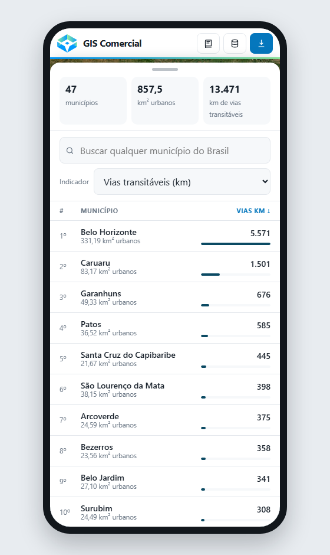

*Da esquerda para a direita, de cima para baixo: painel no meio com a lista; detalhe de Bezerros; painel recolhido (mapa quase inteiro); painel em tela cheia.*

### Instalar na tela inicial

O mapa pode ser instalado como um aplicativo, com ícone próprio e abrindo em tela cheia, sem a barra do navegador:

| Aparelho | Como instalar |
|---|---|
| **Android (Chrome)** | Abra o endereço do mapa, toque no menu **⋮** e em **Instalar app** (ou **Adicionar à tela inicial**) |
| **iPhone / iPad (Safari)** | Abra o endereço do mapa, toque em **Compartilhar** (quadrado com seta) e em **Adicionar à Tela de Início** |
| **Computador (Chrome / Edge)** | Clique no ícone de instalar, no fim da barra de endereço |

O app instalado usa a internet como o site: os dados ficam sempre atualizados.

### Links diretos

Dá para compartilhar um link que já abre o mapa num estado específico:

| Link | Abre |
|---|---|
| `…/gis-comercial/?mun=2604106` | Caruaru selecionado (use o código IBGE do município) |
| `…/gis-comercial/?mun=2604106&zoom=15` | Caruaru com zoom 15 |
| `…/gis-comercial/?mun=2604106&mancha=Carapotós (4)` | Caruaru com zoom na mancha Carapotós (4) (nome como aparece na tabela) |
| `…/gis-comercial/?ind=dens` | Mapa colorido por densidade de vias (`vias`, `urb`, `dens` ou `perc`) |
| `…/gis-comercial/?mun=2601904&baixar` | Bezerros com a janela de relatório aberta |
| `…/gis-comercial/?selecao` | Janela do relatório de municípios aberta |
| `…/gis-comercial/?manual` | Manual aberto |

---

## Parte 2: Entender os números

### Área urbana

Soma das manchas formadas pelos **setores censitários urbanos do IBGE 2022** (situação CD_SIT 1, 2 ou 3), conforme a extração do CONIAPE. Cada município pode ter várias manchas: a sede, distritos e povoados.

### Vias transitáveis (critério 360°)

Extensão, em km, das vias do **OpenStreetMap** que um veículo percorre, **recortadas no limite das manchas urbanas**. Só conta o trecho de cada via que está dentro da mancha.

**Entram** (tag `highway` do OSM): `motorway`, `trunk`, `primary`, `secondary`, `tertiary` e as respectivas alças `*_link`, `unclassified`, `residential`, `living_street`, `service`, `road` e `track` (ruas de terra).

**Ficam de fora**, mesmo dentro da mancha:
- vias com acesso privado ou proibido (`access=private/no`, `motor_vehicle=no`, `vehicle=no`)
- corredores de estacionamento, entradas de garagem e drive-thrus (`service=parking_aisle/driveway/drive-through`)
- calçadões, caminhos, escadas e ciclovias (não estão no filtro)

O comprimento é medido em SIRGAS 2000 / UTM 25S (EPSG:31985). Base OSM: 15/10/2026.

### Valor original do CONIAPE

O CONIAPE contava o **comprimento inteiro de toda via que toca a mancha urbana**, inclusive o trecho fora dela. Por isso as estradas que saem da cidade entravam inteiras, e o número original costuma ser **maior** que o transitável recortado. Exemplos: São Bento do Una 227 → 130 km; Bezerros 460 → 358 km.

O mapa e os relatórios gerados mostram os dois valores. Os **relatórios oficiais em PDF** continuam com o valor original.

### Casos especiais

- **Caruaru:** a extração original do CONIAPE estava **incompleta**: faltava a maior parte dos eixos do centro (1.016 km no original). Na nova extração, as manchas pequenas bateram exatamente com o original, o que valida o método. O valor atual é 1.501,18 km.
- **Municípios gerados sob demanda:** seguem o mesmo critério dos 39 do CONIAPE (vias transitáveis recortadas nas manchas urbanas). Diferenças pequenas: a medição usa o **fuso UTM do próprio município** (de 18S a 25S; os de PE ficam em 25S, salvo o Sertão); a **área territorial** vem da API do IBGE (agregados 2022), enquanto nos 39 vem da malha de 2024, então pode haver diferença de ~1%; e a **numeração das manchas** de um distrito segue a ordem de tamanho. Validação: Bezerros, gerado do zero por esse método, deu 357,57 km de vias contra 357,58 km do valor revisado (diferença de 0,00%), com os mesmos 103 setores e 4 manchas.
- **Auditoria:** os 39 municípios foram comparados com o OSM atual pelo critério original. Só Caruaru tinha falha de extração (mais de 10% de diferença); veja `dados/auditoria_vias_osm_resumo.md`.

### Áreas do território

- **Território (área oficial IBGE):** área publicada pelo IBGE, que é a referência.
- **Território (planimétrica UTM 25S):** área calculada no plano da projeção. Difere pouco no Agreste; em municípios do Sertão, fora do fuso 25, a diferença chega a cerca de 2%.

---

## Parte 3: Baixar os dados

Todos os arquivos ficam na pasta [`dados/`](https://github.com/montieur/gis-comercial/tree/main/dados) do repositório:

| Arquivo | Conteúdo |
|---|---|
| [CONIAPE_PE_UTM25S_gpkg.zip](https://montieur.github.io/gis-comercial/dados/CONIAPE_PE_UTM25S_gpkg.zip) | GeoPackages: `PE_Municipios_CONIAPE_UTM25S.gpkg` e `CONIAPE_PE_UTM25S.gpkg` (camadas `vias_urbanas` e `areas_urbanas`) |
| [CONIAPE_PE_UTM25S_shp.zip](https://montieur.github.io/gis-comercial/dados/CONIAPE_PE_UTM25S_shp.zip) | Os mesmos dados em shapefile |
| [quantitativos_municipios.csv](https://montieur.github.io/gis-comercial/dados/quantitativos_municipios.csv) | Um município por linha (abre direto no Excel: `;` e vírgula decimal) |
| [quantitativos_manchas.csv](https://montieur.github.io/gis-comercial/dados/quantitativos_manchas.csv) | Uma mancha urbana por linha |
| [auditoria_vias_osm.csv](https://montieur.github.io/gis-comercial/dados/auditoria_vias_osm.csv) | Comparação CONIAPE × OSM por município |
| [revisoes.json](https://montieur.github.io/gis-comercial/dados/revisoes.json) | Registro técnico das revisões: valores, critério, km por tipo de via, excluídas, manchas |
| [Manual_GIS_Comercial.pdf](https://montieur.github.io/gis-comercial/dados/Manual_GIS_Comercial.pdf) | Este manual em PDF, com os prints |

Todas as camadas estão em **SIRGAS 2000 / UTM zona 25S (EPSG:31985)**.

### Campos: municípios (`PE_Municipios_CONIAPE_UTM25S`)

| Campo | Descrição |
|---|---|
| `CD_MUN`, `NM_MUN` | Código e nome IBGE do município |
| `NM_RGI`, `NM_RGINT` | Regiões geográficas imediata e intermediária (IBGE) |
| `CONIAPE` | `Sim` para os 39 municípios do CONIAPE |
| `AREA_IBGE` | Área territorial oficial IBGE (km²) |
| `AREA_UTM` | Área planimétrica em UTM 25S (km²) |
| `AREA_URB`, `AREA_RUR` | Área urbana e rural pelos setores IBGE 2022 (km²) |
| `VIAS_KM` | Vias transitáveis recortadas nas manchas (km) |
| `PERC_URB` | Área urbana / território (%) |
| `DENS_VIAS` | `VIAS_KM` / `AREA_URB` (km/km²) |
| `SETORES` | Número de setores censitários urbanos |
| `DISTRITOS` | Número de manchas urbanas |
| `FONTE` | Origem dos dados e data da revisão |

### Campos: vias (`vias_urbanas`) e áreas urbanas (`areas_urbanas`)

| Camada | Campos |
|---|---|
| `vias_urbanas` | `CD_MUN`, `NM_MUN`, `NOME_VIA` (nome da rua ou, sem nome, o tipo OSM), `COMP_KM` (trecho dentro da mancha, km) |
| `areas_urbanas` | `CD_MUN`, `NM_MUN`, `NOME` (mancha), `AREA_KM2` |

---

## Parte 4: Atualizar e publicar (manutenção)

### Requisitos

- **QGIS 3.44 LTR (OSGeo4W)**, com `C:\OSGeo4W\bin\python-qgis-ltr.bat` para os scripts PyQGIS
- **Python 3** (`C:\Python314\python.exe`) para os scripts sem QGIS
- **Git** e **GitHub CLI** (`gh`) logado na conta `montieur`
- Pastas de origem do CONIAPE em `Desktop\CONIAPE` (uma por município, com `quantitativos.json` e os KMLs)

### Estrutura de pastas

```
CONIAPE\MAPA_PE\
├─ 00_osm_download\   vias baixadas do OSM (GeoJSON por município)
├─ 01_dados\          intermediários: revisoes.json, auditoria, GeoJSON da web
├─ 02_shape_utm\      produtos finais em UTM 25S (.gpkg e shp\)
└─ 03_mapa_html\      ESTE repositório (site + dados\ + build\)
```

### Scripts (`build/`)

| Script | Para quê |
|---|---|
| `prep_coniape.py` | Lê os `quantitativos.json` do CONIAPE e gera CSV e listas de KML |
| `osm_vias_municipio.py <pasta> [transitavel]` | Baixa as vias do município no OSM (Overpass) |
| `vias_transitaveis_mancha.py` | Filtra as vias transitáveis e recorta nas manchas (PyQGIS) |
| `medir_vias_manchas.py` | Mede pelo critério antigo do CONIAPE (via inteira), para auditoria |
| `aplicar_revisao_vias.py` / `aplicar_revisao_lote.py` | Grava as vias novas nos produtos UTM e em `revisoes.json` |
| `remover_municipio.py <CD_MUN>` | Tira um município do CONIAPE nos produtos (vias, manchas, quantitativos) |
| `build_data.py` | Gera o `data.js` do mapa e copia os PDFs oficiais |
| `compilar_pacote.py` | Gera os ZIPs e CSVs de `dados/` |
| `capturar_prints.py` | Tira os prints deste manual (`docs/img/`) e gera o PDF do manual, com o Edge headless |
| `gerar_icones.py` | Gera os ícones PNG do app a partir de `icones/icone.svg` |
| `semear_base.py` | Envia os 39 municípios do CONIAPE ao servidor (catálogo e conferência de atualização) |
| `gerar_lista_municipios.py` | Gera `dados/municipios_ibge.json`, a lista dos 5.571 municípios para a busca |
| `auditoria/` | Scripts auxiliares da auditoria CONIAPE × OSM |

### Servidor e geração sob demanda

A busca por qualquer município usa um servidor (Supabase) e uma automação (GitHub Actions). O passo a passo para ligar está em [`supabase/IMPLANTAR.md`](https://github.com/montieur/gis-comercial/blob/main/supabase/IMPLANTAR.md). Resumo das peças:

| Peça | Onde | O que faz |
|---|---|---|
| Tabelas e bucket | `supabase/migrations/` | `gc_municipios` (catálogo), `gc_pedidos` (fila) e o bucket público `gc-municipios` |
| Função `gc-solicitar` | `supabase/functions/` | Valida o pedido, limita abuso, confere as fontes de um município existente e enfileira |
| Verificação das fontes | `supabase/functions/_shared/verificar.ts` | IBGE (data do arquivo) e OSM (vias alteradas desde a extração) |
| Gerador | `worker/gerar_municipio.py` | Gera um município: setores do IBGE, vias do OSM, recorte e medição |
| Processador da fila | `worker/processar_fila.py` | Lê os pedidos, gera, grava o resumo no Storage, os arquivos GIS no Drive, atualiza a planilha e marca como pronto ou erro |
| Google Drive | `worker/drive.py` | Pasta "GIS Comercial" (uma pasta por estado e por município) e planilha geral; autorização no segredo `GOOGLE_OAUTH` |
| Relatórios PDF no Drive | `worker/relatorio_pdf.py` | Abre o site num Chrome sem tela, gera o relatório do mapa e o envia ao Drive (substitui o anterior) |
| Cópia dos PDFs oficiais | `worker/enviar_relatorios.py` | Copia `relatorios/*.pdf` para a pasta "Relatórios" do Drive (workflow `copiar-relatorios.yml`) |
| Automação | `.github/workflows/processar-fila.yml` | Roda o processador (na hora, pelo disparo da função, e também pela agenda do GitHub). A opção **refazer_pdfs** refaz os relatórios PDF de todos os municípios |
| Configuração do mapa | `config.js` | Endereço e chave pública do Supabase; vazio = busca e geração desligadas |

Para gerar um município sem o servidor (teste ou conferência), no computador:

```bat
C:\Python314\python.exe -X utf8 worker\gerar_municipio.py 2606408 --saida gravata.json
```

O arquivo gerado traz o resumo, as manchas, as vias e a procedência das fontes. O teste de ponta a ponta da fila, com um servidor falso, é `worker\teste_fila_local.py <código IBGE>`.

### Atualizar as vias de um município

Exemplo com Bezerros (`04_Bezerros`, código `2601904`). Rode na pasta `03_mapa_html\build`:

```bat
C:\Python314\python.exe -I osm_vias_municipio.py 04_Bezerros transitavel
C:\OSGeo4W\bin\python-qgis-ltr.bat vias_transitaveis_mancha.py ..\..\00_osm_download\04_Bezerros_osm_vias_transitavel.geojson 04_Bezerros 2601904 ..\..\01_dados\bezerros.gpkg ..\..\01_dados\bezerros.json
C:\OSGeo4W\bin\python-qgis-ltr.bat aplicar_revisao_vias.py 2601904 ..\..\01_dados\bezerros.gpkg ..\..\01_dados\bezerros.json
C:\Python314\python.exe -I build_data.py
C:\Python314\python.exe -I compilar_pacote.py
```

Para vários municípios de uma vez, ponha os pares `<pasta>_transitavel.gpkg` / `.json` numa pasta e rode `aplicar_revisao_lote.py <pasta>`.

Cuidados:
- **Faça backup de `02_shape_utm`** antes de aplicar uma revisão. O valor original do CONIAPE fica preservado em `revisoes.json` mesmo depois de várias revisões.
- O Overpass às vezes devolve erro 502/504 ou base desatualizada nos espelhos. Confira a data `base OSM` impressa no download.
- Feche no QGIS as camadas de `02_shape_utm` antes de aplicar, ou ao menos não as edite enquanto o script roda.

### Atualizar os prints e o PDF do manual

Depois de mudar o mapa ou este manual, com o site servido localmente:

```bat
C:\Python314\python.exe -m http.server 8791 --directory C:\Users\tecgeo-jordy\Desktop\CONIAPE\MAPA_PE\03_mapa_html
C:\Python314\python.exe -I build\capturar_prints.py http://localhost:8791
```

O script regrava os prints em `docs/img/` e o `dados/Manual_GIS_Comercial.pdf`, gerado a partir de `manual.html`. Os prints de celular saem numa moldura de 390 × 844 px (`build/moldura_celular.html`).

### Publicar

Na pasta `03_mapa_html`:

```bat
git add -A
git commit -m "Atualiza vias de <município>"
git push
```

O GitHub Pages atualiza o site em 1 a 2 minutos. O `build_data.py` grava uma versão no endereço do `data.js` e do `relatorio.js` (`?v=<hash>`), para o navegador não reaproveitar dados antigos do cache.

### Configurações no código

- **`PDF_BASE_URL`** (`index.html`): onde ficam os relatórios oficiais. Vazio = pasta `relatorios/` do próprio site.
- **`PDF_TILES`** (`relatorio.js`): mapa base dos PDFs (Esri cinza claro + rótulos).

---

*TECGEO · Dados: IBGE (malha municipal 2024, setores censitários 2022), OpenStreetMap (© colaboradores OSM, ODbL), CONIAPE.*
